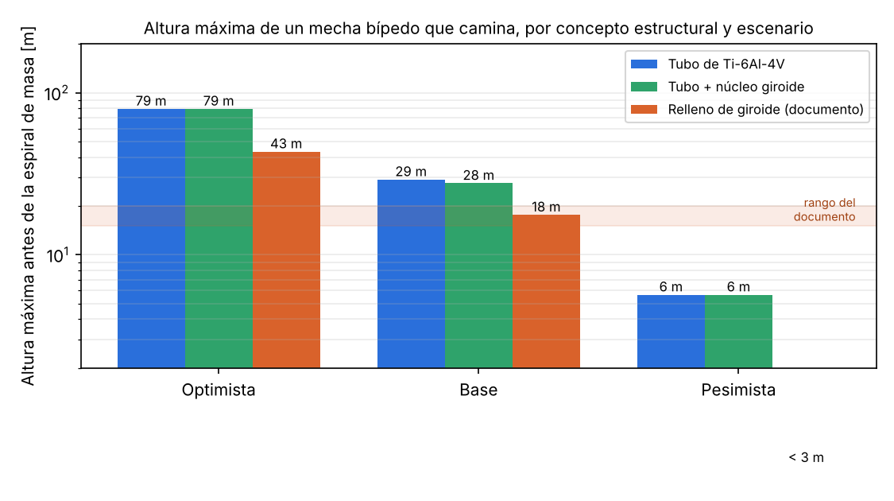
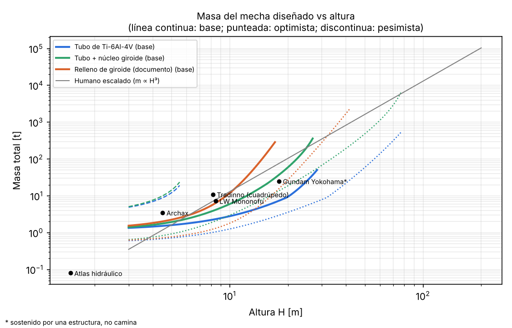
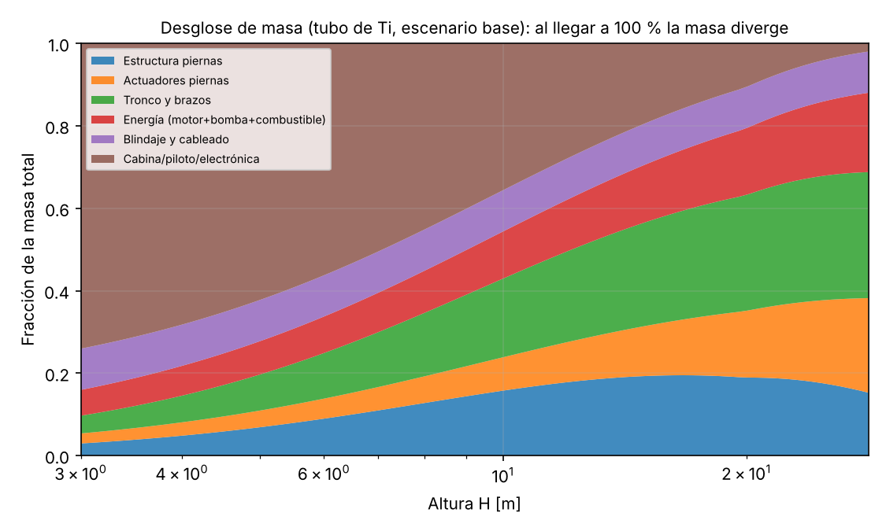
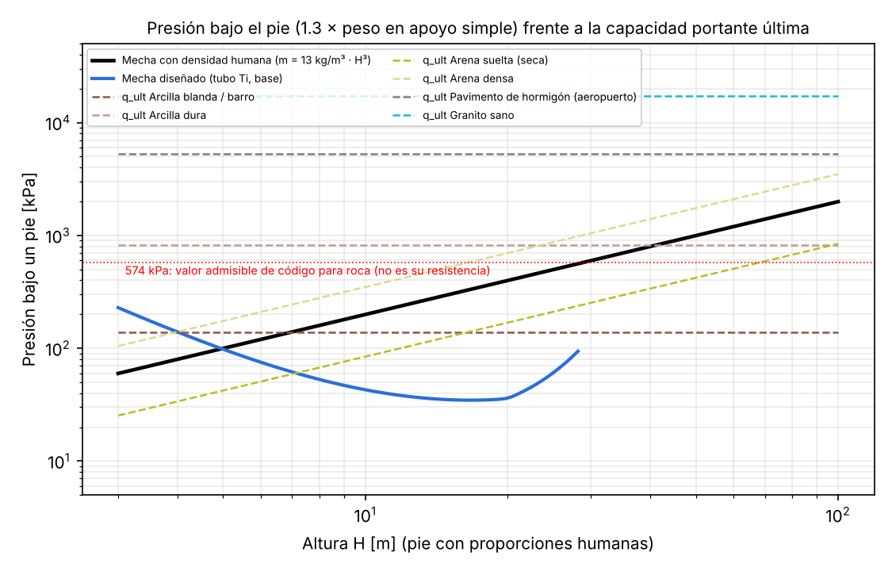
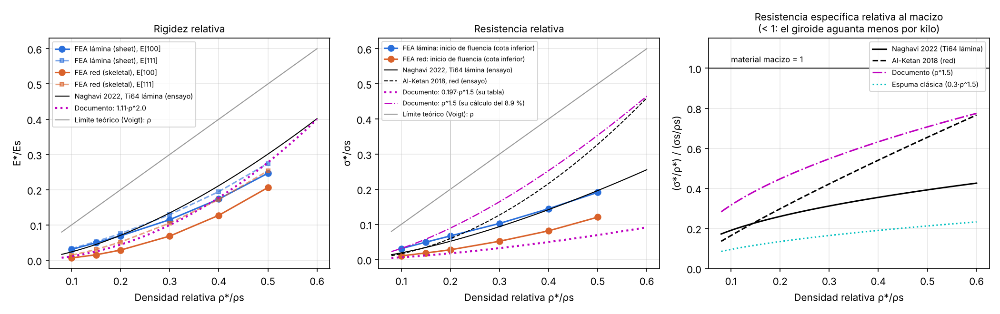
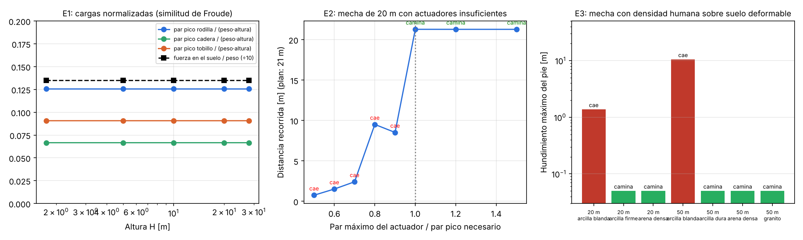

# Mechas realistas

Revisión, verificación de fuentes y validación con simulaciones del documento
**«Mechas, Ley Cuadrado-Cúbica y Giroides»**: ¿cuánto puede medir de verdad un
robot bípedo gigante que camina?

## Resultado en una frase

Con la tecnología actual de materiales y actuadores, un mecha bípedo que camina
puede medir **unos 30 m en el escenario base**. Ese número sale de supuestos
realistas, pero no conservadores. El rango completo va de **~6 m** (supuestos de
la robótica actual, el tamaño de lo que se ha construido de verdad) a **~80 m**
(supuestos optimistas). Lo que lo limita **no es la estructura** sino la
masa de **actuadores y energía**, que crece más rápido que el propio mecha.
Rellenar las piernas de giroide, como propone el documento, **reduce** la
altura máxima (≈18 m frente a ≈29 m de un tubo de titanio de pared delgada).

## Principales conclusiones

1. **El giroide no «hackea» la ley cuadrado-cúbica.**
   - Su resistencia **por kilo** es siempre menor que la del material macizo:
     del 6 % al 45 % según las fuentes.
   - La teoría (cota de Voigt) impide superarla.
   - Nuestro análisis por elementos finitos reproduce la literatura.
   - El giroide sirve como **núcleo** de paredes delgadas contra el pandeo, no
     como relleno estructural.
2. **La estructura no es el cuello de botella.** Un tubo de Ti-6Al-4V de
   pared delgada (como un exoesqueleto de insecto) aguanta las cargas de un mecha
   de 20 m con paredes de 3 mm.
3. **El cuello de botella son los actuadores y la energía.**
   - La masa de los actuadores crece ∝ H⁴ y la potencia ∝ H^3.5, mientras el
     mecha crece ∝ H³.
   - Por eso hay una altura a la que la masa ya no converge («espiral de masa»).
   - En simulación, un mecha con actuadores por debajo del 100 % del par
     necesario **se cae**.
4. **El suelo depende del terreno.**
   - En **arcilla blanda**, un mecha de 20 m con densidad humana (104 t) se
     hunde y cae.
   - En **arena densa, arcilla dura, roca o pavimento**, incluso uno de 50 m
     (1600 t) camina.
   - Los 574 kPa «del granito» del documento son un valor admisible de un código
     residencial, no la resistencia de la roca (que es de >100 MPa).
5. **Similitud dinámica verificada.** Con escala de Froude (tiempo ∝ √H), los
   pares normalizados son idénticos de 1.75 m a 28 m.
   - En los casos en que el mecha camina, MuJoCo y Gazebo coinciden en la
     distancia recorrida con una diferencia menor del 0.1 %.
   - Con actuadores al 70 % del par necesario, los dos se caen.

La verificación afirmación por afirmación, con enlaces a las fuentes, está en
[`docs/verificacion_fuentes.md`](docs/verificacion_fuentes.md). El documento
corregido, con estas conclusiones, figuras y tablas, está copiado en
[`docs/documento.md`](docs/documento.md).

## ¿Y si fuera cuadrúpedo?

Más alto, no; más pesado y más largo, sí. Se simuló en MuJoCo un cuadrúpedo con
cuatro patas idénticas a las del bípedo y se pasó por el mismo modelo de
dimensionado. El detalle está en [`docs/cuadrupedo.md`](docs/cuadrupedo.md).

- **Cada pie carga la mitad** (≈0.5 × peso frente a ≈1.0), pero hay el doble de
  patas que construir y que balancear. La suma de par × recorrido de los
  actuadores apenas baja.
- **Altura equivalente máxima, escenario base:**
  - a igual velocidad, el cuadrúpedo llega a 23 m y el bípedo a 45 m;
  - yendo al 45 % de la velocidad del bípedo, el cuadrúpedo llega a 43 m.
- **Para las mismas patas, el cuadrúpedo pesa más.** Con patas de 21 m pesa
  ~290 t, mide 26 m hasta el lomo y unos 27 m de largo.
- **Su ventaja está en el suelo y en la estabilidad.** Aplica la mitad de
  presión por pie y no necesita mantener el equilibrio.

## Altura máxima por escenario (espiral de masa)

| Concepto estructural de las piernas | Optimista | Base | Pesimista |
|---|---|---|---|
| Tubo de Ti-6Al-4V de pared delgada | 79 m | **29 m** | 6 m |
| Tubo + núcleo de giroide | 79 m | 28 m | 6 m |
| Sección rellena de giroide (documento) | 43 m | **18 m** | < 3 m |

**Optimista:**
- actuadores tipo gato industrial (0.24 kg/kJ);
- grupo motor-bomba de 300 W/kg;
- eficiencia hidráulica del 60 %;
- márgenes de seguridad mínimos.

**Base:**
- cilindros de 0.5 kg/kJ;
- 150 W/kg;
- eficiencia del 45 %;
- factor de carga 1.5.

**Pesimista:** actuadores de robótica (2 kg/kJ), 100 W/kg y eficiencia del 30 %.

Todos los valores tienen fuente; ver `scaling/mech_scaling.py` y
`docs/investigacion/parametros_modelo.md`.

Por material (tubo, escenario base):

| Material | Altura máxima |
|---|---|
| CFRP laminado | 33 m |
| Ti-6Al-4V LPBF + HIP | 29 m |
| Acero 4340 | 25 m |
| Al 7075-T6 | 23 m |
| Ti-6Al-4V sin HIP | 22 m |








## Qué hay en el repositorio

```
gyroid_fea/         Elementos finitos (vóxeles, homogenización periódica) de celdas giroides
                    lámina y red: rigidez, anisotropía, concentración de tensiones
scaling/            Modelo de dimensionado del mecha en función de la altura
  mech_scaling.py     estructura (tubos con pandeo local NASA SP-8007 o giroide Gibson-Ashby),
                      actuadores hidráulicos, energía, espiral de masa, escenarios
  soil.py             capacidad portante de Terzaghi/Vesić y hundimiento de equilibrio
  run_analysis.py     barridos y figuras
  compare_quad.py     bípedo frente a cuadrúpedo en el modelo de dimensionado
sim/                Simulación física en MuJoCo
  mech_model.py       bípedo paramétrico (antropometría de Winter) escalable a cualquier altura
  gait.py             marcha: control predictivo del ZMP (Kajita) + cinemática inversa
  walk.py             simulación, fuerzas de contacto, presión bajo el pie, suelo deformable
  experiments.py      E1 marcha a varias alturas, E2 actuadores insuficientes, E3 suelo
  make_videos.py      vídeos de los casos representativos
  quad_model.py       cuadrúpedo con cuatro patas idénticas a las del bípedo
  quad_walk.py        paso de gateo estable, reparto de carga entre patas, simulación
  quad_experiments.py bípedo frente a cuadrúpedo medidos igual, y vídeos
gazebo/             El mismo mecha exportado a Gazebo Harmonic (SDF) y verificación cruzada
results/            JSON, figuras, vídeos y salidas de Gazebo
docs/               Verificación de fuentes y notas de investigación
  documento.md        copia en Markdown del documento corregido
  gdoc/               contenido del documento y scripts que lo escribieron en Google Docs
```

## Cómo reproducirlo

```bash
python3 -m venv .venv && . .venv/bin/activate
pip install -r requirements.txt
```

```bash
python gyroid_fea/run_sweep.py          # ~30 min (FEA de giroides)
python gyroid_fea/plot_results.py
python scaling/run_analysis.py          # límites de altura y figuras
python sim/experiments.py all           # E1, E2, E3 en MuJoCo
python sim/plot_results.py
MUJOCO_GL=osmesa python sim/make_videos.py   # sin GPU; con GPU usar MUJOCO_GL=egl
python sim/quad_experiments.py          # bípedo frente a cuadrúpedo
python scaling/compare_quad.py
MUJOCO_GL=osmesa python sim/quad_experiments.py --solo-videos
```

### Gazebo

Requiere Gazebo Harmonic con sus bindings de Python (en Ubuntu 24.04:
`gz-harmonic`, `python3-gz-transport13` y `python3-gz-msgs10`, que funcionan con
`python3.12`).

```bash
# exportar un mecha de 20 m con la masa del diseño base y actuadores a 1.5 × el par pico
python gazebo/export_sdf.py --H 20 --M 9480 --torque-factor 1.5 --out gazebo/out_H20
# ejecutar sin interfaz y registrar la marcha
python3.12 gazebo/run_gazebo.py gazebo/out_H20
```

```bash
# o con interfaz gráfica: primero abre el mundo
GZ_SIM_RESOURCE_PATH=gazebo/out_H20 gz sim -r gazebo/out_H20/world.sdf
# y en otra terminal envía la marcha
python3.12 gazebo/run_gazebo.py gazebo/out_H20 --no-server
```

`gazebo/sweep.sh` repite los casos de verificación cruzada:

| Caso | Gazebo | MuJoCo |
|---|---|---|
| Humano 1.75 m | camina 1.86 m | camina 1.86 m |
| 20 m, diseño | camina 21.27 m | camina 21.28 m |
| 28 m, diseño | camina 29.78 m | camina 29.79 m |
| 20 m, par al 70 % | cae | cae |

## Vídeos

| Vídeo | Qué muestra |
|---|---|
| `results/videos/e1_marcha_H1.75.mp4` | Humano de referencia (1.75 m, 70 kg) |
| `results/videos/e1_marcha_H20.mp4` | Mecha de 20 m del diseño base (≈9.5 t) |
| `results/videos/e1_marcha_H28.mp4` | Mecha de 28 m, al borde de la espiral de masa (≈47 t) |
| `results/videos/e2_par_60pct_H20.mp4` | 20 m con actuadores al 60 % del par necesario: cae |
| `results/videos/e3_arcilla_blanda_H20.mp4` | 20 m con densidad humana (104 t) en arcilla blanda: se hunde y cae |
| `results/videos/e3_arcilla_blanda_H50.mp4` | 50 m (1600 t) en arcilla blanda: se hunde ~10 m y cae |
| `results/videos/e3_arena_densa_H50.mp4` | 50 m (1600 t) en arena densa: camina |
| `results/videos/cuadrupedo_H1.75.mp4` | Cuadrúpedo de referencia, patas de 0.93 m |
| `results/videos/cuadrupedo_H20.mp4` | Cuadrúpedo con patas de 10.6 m (≈14 t), gateo lento |
| `results/videos/cuadrupedo_H40.mp4` | Cuadrúpedo con patas de 21 m (≈290 t), cerca del límite |
| `results/videos/cuadrupedo_rapido_H20.mp4` | Cuadrúpedo con patas de 10.6 m (≈33 t), gateo rápido |

Los vídeos se reproducen con el tiempo de una persona: un segundo de vídeo son
√(H/1.75) segundos reales. Las referencias de escala son una persona de 1.75 m
(roja) y un autobús de 12 m (amarillo).

## Supuestos y limitaciones

- **Marcha lenta y con pies planos, tipo ZMP.** Es la que usan los humanoides
  grandes, con número de Froude ≈ 0.01, es decir, ~0.9 m/s para un mecha de
  20 m. Correr o saltar multiplica las cargas por 2–3.
- **Masa repartida como en el cuerpo humano** (tablas de Winter). El tronco y
  los brazos están agrupados en un sólido rígido; no se simulan los brazos.
- **Suelo deformable aproximado.** Es un modelo cuasi-estático de
  punzonamiento (Terzaghi/Vesić con profundidad), no un modelo continuo de
  suelo. Sirve para decidir si el mecha se hunde o no, no para predecir la
  forma exacta de la huella.
- **Las tensiones de fluencia del FEA son el inicio de la plastificación**
  (análisis lineal, cota inferior). Para resistencia se usan los ensayos
  publicados.
- **Fuera del modelo:** fatiga de uniones soldadas, control de equilibrio ante
  empujones o caídas, calor y fiabilidad.
