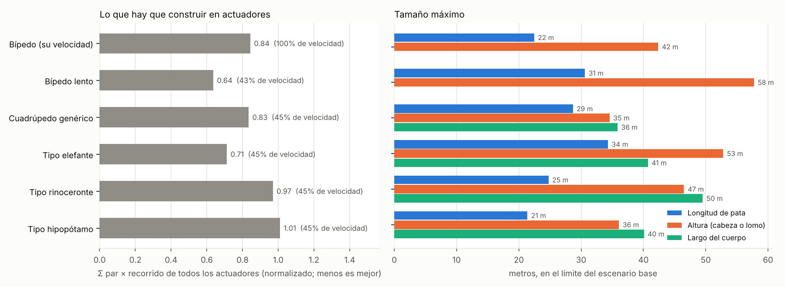

# Mechas con patas de elefante, rinoceronte e hipopótamo

Pregunta: los tres animales terrestres más pesados son el elefante, el
rinoceronte y el hipopótamo. ¿Un mecha cuadrúpedo con sus proporciones y su
postura podría ser más grande?

**Respuesta corta:**

- **El elefante sí ayuda.** Es el mejor cuadrúpedo de los probados:
  - patas hasta 34 m, lomo a 53 m y unos 41 m de largo, en el escenario base;
  - frente a patas de 29 m del cuadrúpedo genérico.
  - El rasgo que importa es la **postura**: patas más rectas. Ahorran un 16 % de
    actuadores.
- **El rinoceronte y el hipopótamo no ayudan.** Sus patas flexionadas y sus
  cuerpos largos exigen más par.
  - El hipopótamo, además, tiene pies pequeños: presión de ~200 kPa, la de un
    neumático de coche.
- **Frente al bípedo, el tipo elefante:**
  - es casi igual de alto que un bípedo que camine a su misma velocidad (53 m de
    lomo frente a 58 m de cabeza);
  - pesa mucho más cerca de su límite;
  - nunca necesita equilibrarse.

## Cómo se ha hecho

### Proporciones de cada animal

Salen de [`investigacion/elefante_rinoceronte_hipopotamo.md`](investigacion/elefante_rinoceronte_hipopotamo.md),
con fuentes. Todo se normaliza con L, la altura de la cadera.

| | Elefante | Rinoceronte blanco | Hipopótamo |
|---|---|---|---|
| Hombro–cadera / L | 0.95 | 1.6 | 1.5 |
| Ancho de vía / L | 0.27 | 0.30 | 0.39 |
| Canto del cuerpo / L | 0.59 | 1.0 | 0.8 |
| Altura del lomo / L | 1.44 | 1.55 | 1.3 |
| Postura (flexión mínima de rodilla en apoyo) | 24° (codo 23°, rodilla 28°; Ren et al. 2008) | 46° («flexión notable»; huesos a 39–50° de la fuerza, Alexander y Pond 1992) | 46° («menos rectas») |
| Peso delante | 60 % (Ren et al. 2010) | 62 % (Etienne et al. 2024) | 60 % (supuesto) |
| Pie (área / L²) | 0.04, redondo y centrado | 0.035, 0.29 × 0.23 L | 0.02, sin dato publicado |
| Pisadas | secuencia lateral | secuencia lateral | trote (Hutchinson y Pringle 2024) |

El **cuadrúpedo genérico** de la comparación anterior sirve de base:
- cuerpo tan largo como la pata;
- vía de 0.49 L;
- rodilla flexionada al menos 48°;
- pie humano;
- peso repartido 50/50.

Todas las patas tienen dos segmentos iguales, la misma masa (un 32 % del total
entre las cuatro, el 33 % que estiman las fuentes) y 5 grados de libertad.

### Marcha (`sim/quad_gait.py`)

- **Fases propias.** Cada pata sigue su propia fase del ciclo, como en los
  animales: secuencia lateral con desfases del 25 %, o trote con las diagonales
  juntas.
- **Pisadas:** cada pata aterriza donde quedará bajo su cadera a mitad del apoyo.
- **ZMP:** se mantiene dentro del polígono de apoyo de cada instante, con margen.
- **Altura del cuerpo:** la que permite la pata apoyada más estirada con la
  flexión mínima de la postura. Con patas rectas, el cuerpo sube y baja un 3 %
  de L, como el elefante (3–4 %).
- **Igual para todos:**
  - factor de apoyo 0.79;
  - zancada de 0.45 L por ciclo;
  - número de Froude 0.0017 (0.12 m/s con patas de 0.93 m, el 45 % de la
    velocidad del bípedo).

### Par necesario por dinámica inversa (`sim/inverse_dynamics.py`)

**Por qué no la simulación directa.** Mide los pares de un controlador concreto,
y con cuatro patas hay un problema. Si las patas están casi rectas, un servo de
posición rígido convierte errores de milímetros en fuerzas enormes. Eso es un
defecto del controlador, no algo que la máquina necesite.

**Qué se hace en su lugar.** Para cada instante del plan se calculan las
fuerzas necesarias y se reparten entre los pies apoyados del modo que **minimiza
los pares articulares**. Es lo que haría un control de fuerza de cuerpo entero.
Se comprueba que:
- el centro de presiones de cada pie queda dentro de la suela;
- no hace falta más rozamiento que μ = 0.6.

El bípedo se calcula igual. **Validación con el bípedo:** la rodilla da 0.098 ×
peso × H tanto por dinámica inversa como en la simulación directa, y la carga
por pie da 1.04 frente a 1.03.

La simulación directa en MuJoCo se sigue usando para comprobar que cada diseño
camina sin caerse, y para los vídeos.

### Tamaño (`scaling/compare_animals.py`)

Es el mismo modelo de espiral de masa del bípedo, con cuatro patas. Cada
arquetipo añade lo suyo:
- **Cuerpo:** una viga tubular entre caderas y hombros, con su luz, su canto y
  su torsión.
- **Pie:** el del arquetipo, que fija la presión sobre el suelo.

## Resultados

### Lo que hay que construir en actuadores

Es la suma de par × recorrido de todos los actuadores (normalizada), a la
velocidad indicada:

| Diseño | Velocidad | Σ par × recorrido | Carga máx. por pie |
|---|---|---|---|
| Bípedo (marcha de E1) | 100 % | 0.84 | 1.04 × peso |
| Bípedo lento | 43 % | **0.64** | 1.03 |
| Cuadrúpedo genérico | 45 % | 0.83 | 0.61 |
| **Tipo elefante** | 45 % | **0.71** | 0.61 |
| Tipo rinoceronte | 45 % | 0.97 | 0.63 |
| Tipo hipopótamo (trote) | 45 % | 1.01 | 0.67 |

Si la pata delantera dobla como en el animal (codo hacia atrás), los tres
empeoran: elefante 0.89, rinoceronte 1.53 e hipopótamo 1.61. Por eso los
arquetipos de la tabla la doblan hacia delante.

**Qué rasgo del elefante ayuda** (partiendo del cuadrúpedo genérico, 0.83):

| Rasgo | Solo | Acumulado |
|---|---|---|
| Postura: patas más rectas | **0.70 (−16 %)** | 0.70 |
| Vía estrecha | 0.79 | 0.70 |
| Cuerpo corto | 0.84 | 0.70 |
| Cuerpo alto y profundo | 0.83 | 0.70 |
| 60 % del peso delante | 0.89 | 0.63 |
| Pies redondos grandes | 0.79 | 0.71 |
| Codo hacia atrás | 1.01 (+22 %) | 0.89 |

### Tamaño máximo (escenario base)

| Diseño | Pata | Altura (cabeza o lomo) | Largo | Masa al 80 % del límite | Presión por pie |
|---|---|---|---|---|---|
| Bípedo (marcha de E1) | 22 m | 42 m | — | 42 t | 44 kPa |
| Bípedo lento | 31 m | 58 m | — | 100 t | 56 kPa |
| Cuadrúpedo genérico | 29 m | 35 m | 36 m | 207 t | 79 kPa |
| **Tipo elefante** | **34 m** | **53 m** | 41 m | 445 t | 69 kPa |
| Tipo rinoceronte | 25 m | 47 m | 50 m | 511 t | 120 kPa |
| Tipo hipopótamo | 21 m | 36 m | 40 m | 224 t | 197 kPa |

> Nota sobre las cifras absolutas: aquí todos los diseños se miden con control
> ideal (dinámica inversa con reparto de fuerzas óptimo). Por eso el bípedo
> llega a 42 m y no a los ~30 m del documento, que usa los picos medidos en la
> simulación directa, más conservadores. Las comparaciones entre diseños son
> válidas porque todos se miden igual. Las cifras absolutas, no.

## Conclusiones

1. **La postura del elefante es lo que más ayuda.** Con patas más rectas, la
   fuerza del suelo pasa cerca de las rodillas y el par baja un 16 %.
   - Pasar la carga a la cadera tiene un límite: con patas casi rectas hay que
     balancear una pata más larga. La flexión óptima ronda los 23–28° del
     elefante real.
   - Vía estrecha y pies grandes ayudan un poco (−5 % cada uno). El largo y el
     canto del cuerpo, nada.
2. **Ese orden coincide con la naturaleza.** El elefante es el mayor animal
   terrestre (6–10 t) y en el modelo es el cuadrúpedo que más crece. El
   rinoceronte (2–3.6 t) y el hipopótamo (1.5–4.5 t), con patas más cortas y
   flexionadas, quedan por detrás en los dos casos.
3. **El rinoceronte y el hipopótamo salen peor que el cuadrúpedo genérico:**
   - por las patas flexionadas;
   - porque su cuerpo largo (1.5–1.6 veces la pata) es una viga más pesada;
   - en el hipopótamo, además, porque el pie pequeño concentra mucha presión
     (~200 kPa): se hundiría en arcilla blanda.
4. **El codo hacia atrás no le conviene al mecha** (+22–60 % de par). En los
   animales tiene otras razones, como la anatomía muscular y la del pie, que no
   se trasladan a una máquina.
5. **Frente al bípedo:**
   - **Altura:** a igual velocidad, el bípedo lento sigue llegando un poco más
     alto (58 m de cabeza frente a 53 m de lomo del tipo elefante) y necesita
     menos actuadores (0.64 frente a 0.71).
   - **Masa:** el tipo elefante es mucho más masivo: 445 t frente a 100 t al
     80 % de sus límites.
   - **Estabilidad:** puede pararse en cualquier momento sin caerse.

## Limitaciones

- **Marcha común.** Todos caminan con factor de apoyo 0.79, número de Froude
  0.0017 y la misma zancada relativa.
  - Los animales usan 0.68 (rinoceronte), 0.73–0.74 (elefante) y 0.76
    (hipopótamo), y caminan más rápido (Fr 0.01–0.10).
  - Con factores de apoyo menores de 0.75, el planificador basado en el ZMP
    exige centros de presión fuera de la suela: haría falta equilibrio dinámico.
- **Patas simplificadas:**
  - dos segmentos iguales (en los animales, fémur/tibia = 1.6–1.75);
  - las delanteras tan largas como las traseras (en el hipopótamo miden ~0.8 L);
  - sin almohadilla elástica.
- **Control ideal.** Es un mínimo de par en cada instante, no un controlador
  real. La simulación directa con servos de posición camina en todos los casos,
  pero con pares mayores.
- **Datos sin verificar:** el pie del hipopótamo, su reparto de peso y su
  postura, y la postura del rinoceronte. Ver el informe de fuentes.

## Vídeos

Cada mecha camina al 80 % de su tamaño máximo del escenario base. Se reproducen
con el tiempo de una persona: un segundo de vídeo son √(H/1.75) segundos
reales.

| Vídeo | Qué muestra |
|---|---|
| `results/videos/animal_elefante.mp4` | Tipo elefante: patas de 27 m, lomo a 42 m, 445 t |
| `results/videos/animal_rinoceronte.mp4` | Tipo rinoceronte: patas de 20 m, lomo a 37 m, 40 m de largo, 511 t |
| `results/videos/animal_hipopotamo.mp4` | Tipo hipopótamo, al trote: patas de 17 m, 224 t |
