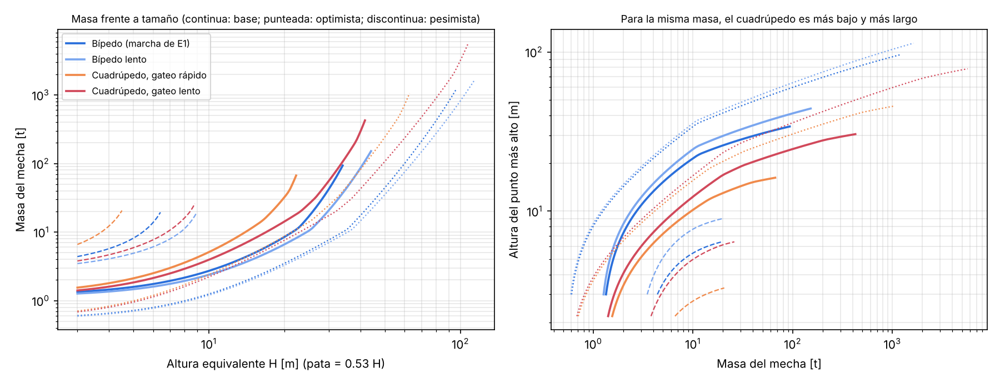

# ¿Y si el mecha fuera cuadrúpedo?

Pregunta: con la misma tecnología, ¿un mecha de cuatro patas podría ser más
grande que el bípedo de ~30 m?

**Respuesta corta:** más alto, no; más pesado y más largo, sí. Con las mismas
patas, el cuadrúpedo llega a la misma longitud de pata máxima que el bípedo, pero
solo si camina más despacio. A igual velocidad sale peor. Su ventaja real está en
otra parte: aplica la mitad de presión por pie, no necesita mantener el
equilibrio y puede cargar más masa cerca del límite.

> **Ampliación:** en [`animales.md`](animales.md) se repite la comparación con un método más limpio
> (dinámica inversa con reparto de fuerzas de par mínimo, igual para todos los diseños) y se prueban
> proporciones de elefante, rinoceronte e hipopótamo. La conclusión se mantiene: con las mismas
> patas, cuatro patas no dan más altura que dos. La postura del elefante es lo que más ayuda.

## Cómo se ha comparado

Para que la comparación sea justa, el cuadrúpedo es literalmente «cuatro
piernas del bípedo bajo un cuerpo horizontal»:

- **Las patas son idénticas:** mismos segmentos, 5 grados de libertad, mismo
  pie, mismos actuadores de posición.
- **El reparto de masa es el mismo:** las cuatro patas suman el 32 % de la masa,
  como las dos piernas del bípedo.
- **Todo escala con la altura equivalente H:** la pata mide 0.53 H, como la
  pierna del bípedo de altura H.

### Simulación (MuJoCo, `sim/quad_model.py`, `sim/quad_walk.py`)

**Marcha.** Es un paso de gateo estáticamente estable: siempre hay tres pies en
el suelo, con un factor de apoyo de 0.79–0.82, por encima del 0.75 que exige la
estabilidad estática (McGhee y Frank 1968). Las patas se mueven en secuencia
lateral, como el paso de los mamíferos.

**Planificación.**
- El centro de masa sale del mismo control predictivo del ZMP que usa el bípedo.
- El cuerpo avanza de forma continua y solo se desplaza lo necesario para quedar
  dentro del triángulo de apoyo, con un margen de 0.03 H.

**Control de reparto de carga.** Cuatro patas rígidas sobre suelo rígido son
hiperestáticas: sin control de fuerza, el peso acaba sobre una diagonal (la
«mesa coja») y las patas se empujan entre sí. Cada pata apoyada se alarga o se
acorta según la diferencia entre la fuerza que lleva y la que le asigna el plan.

- La fuerza vertical deseada reparte el peso con el centro de presiones en el ZMP.
- La componente horizontal apunta a la cadera, de modo que la pata trabaja como
  un puntal.

Un cuadrúpedo real también lo necesitaría.

**Prealimentación de velocidad.** Corrige el retraso que el amortiguamiento del
servo introduce en la pata que vuela.

**Medida.** Los dos robots se miden igual: pares y potencias filtrados a 10 Hz
(escala humana, con similitud de Froude). Por encima de eso solo hay vibración
numérica de patas rígidas sobre suelo rígido (45–60 Hz), que un actuador
hidráulico no seguiría. Los valores sin filtrar están en `results/sim_quad.json`.

**Similitud.** Los coeficientes normalizados del cuadrúpedo son iguales a 1.75,
20 y 50 m, con diferencias de menos del 2 %.

### Resultados de la simulación

Pares pico por pata normalizados por peso × H. Potencias normalizadas por
peso × √(gH).

| Caso | Velocidad | Carga máx. por pie | Cadera | Rodilla | Tobillo | Cadera lateral | Potencia pico | Potencia media |
|---|---|---|---|---|---|---|---|---|
| Bípedo (marcha de E1) | 100 % | 1.03 × peso | 0.059 | 0.098 | 0.084 | 0.053 | 0.080 | 0.0150 |
| Bípedo lento | 58 % | 1.02 | 0.029 | 0.099 | 0.066 | 0.059 | 0.029 | 0.0068 |
| Cuadrúpedo, gateo rápido | 58 % | 0.53 | 0.080 | 0.088 | 0.059 | 0.028 | 0.121 | 0.0227 |
| Cuadrúpedo, gateo lento | 45 % | 0.54 | 0.041 | 0.056 | 0.049 | 0.020 | 0.049 | 0.0108 |

La velocidad del 100 % es 0.276 m/s a escala humana, 0.93 m/s para un mecha de
20 m.

**Qué muestra:**

1. **Cada pie del cuadrúpedo carga la mitad.** Lleva ~0.5 × peso frente a
   ~1.0 × peso del bípedo. Coincide con los perros y caballos que caminan (ver
   fuentes).
2. **El par por pata no baja a la mitad.** La rodilla en apoyo sí baja (≈0.05
   frente a 0.10), pero:
   - el cuadrúpedo tiene que **balancear cuatro patas, una cada vez**;
   - para ir a la misma velocidad que el bípedo, cada pata debe volar en la mitad
     de tiempo (0.5 s frente a 1.2 s a escala humana), y el par de balanceo crece
     con el cuadrado de esa rapidez.

   A igual velocidad, la suma de «par × recorrido» de los cuatro patas es mayor
   que la de las dos piernas del bípedo.
3. **Ir despacio le sale más a cuenta.** Con vuelos de 0.7 s, los pares de
   balanceo bajan hasta el nivel de los de apoyo, a costa de ir al 45 % de la
   velocidad del bípedo.

### Modelo de dimensionado (`scaling/compare_quad.py`)

Es el mismo modelo de espiral de masa del bípedo (`scaling/mech_scaling.py`),
ahora con N patas y con los coeficientes medidos de cada caso. El cuerpo
horizontal del cuadrúpedo se calcula como una viga tubular biapoyada entre
caderas y hombros. Soporta:

- la flexión del peso repartido;
- la torsión cuando falta una pata.

No tiene brazos. El resto (cinturas, cabina, cuello) se toma como 0.3 × la masa
de las patas, frente al 0.8 del bípedo, que incluye tronco y brazos. También se
calcula con la misma regla que el bípedo («misma regla»).

**Altura equivalente máxima** (la pata mide 0.53 H) antes de que la masa deje
de converger:

| Caso | Optimista | Base | Pesimista |
|---|---|---|---|
| Bípedo (marcha de E1) | 98 m | **34 m** | 7 m |
| Bípedo lento (58 %) | 116 m | **45 m** | 9 m |
| Cuadrúpedo, gateo rápido (58 %) | 65 m | **23 m** | 5 m |
| Cuadrúpedo, gateo lento (45 %) | 109 m | **43 m** | 9 m |
| Cuadrúpedo lento, misma regla que el bípedo | 90 m | 34 m | 6 m |

**Masa frente a tamaño** (escenario base):

| H equivalente | 10 m | 20 m | 28 m | 34 m | 40 m |
|---|---|---|---|---|---|
| Bípedo | 3 t | 9 t | 29 t | 93 t | — |
| Bípedo lento | 2 t | 7 t | 16 t | 37 t | 85 t |
| Cuadrúpedo lento | 4 t | 14 t | 41 t | 106 t | 292 t |

> Nota: aquí el bípedo de la marcha de E1 llega a 34 m en el escenario base y
> no a los 29 m del informe. La diferencia es el filtrado a 10 Hz de pares y
> fuerzas, que se aplica a los dos robots para compararlos igual. El informe
> usa los picos sin filtrar, más conservadores.

## Conclusiones

1. **Tener cuatro patas, por sí solo, no permite un mecha más alto.**
   - Repartir el peso entre más patas baja la carga de cada una, pero la suma de
     par y recorrido de todos los actuadores, que es lo que pesa, apenas cambia:
     sigue creciendo con el peso × la longitud de la pata.
   - Además hay el doble de patas que balancear.
   - A igual velocidad, el cuadrúpedo llega a menos (23 m frente a 45 m de altura
     equivalente).
   - Yendo más despacio llega a lo mismo (43 m).
2. **Para el mismo tamaño de pata, el cuadrúpedo pesa más, y cerca del límite
   puede pesar mucho más.**
   - Con patas de 21 m (H = 40 m), el cuadrúpedo lento del escenario base pesa
     unas 290 t, mide unos 26 m hasta el lomo y unos 27 m de largo.
   - El bípedo, con 85 t, mide 40 m de alto si va lento, y no llega a ese
     tamaño a su velocidad normal.
3. **Su ventaja está en el suelo y en la estabilidad.**
   - Cada pie carga la mitad; con pies iguales, la presión sobre el terreno es
     la mitad para la misma masa.
   - Además nunca necesita equilibrarse: puede detenerse en cualquier momento,
     caminar todo lo despacio que quiera y quedarse quieto sin caerse.
4. **Encaja con lo que se sabe de animales y máquinas.** Las fuentes, con
   citas, están en
   [`investigacion/cuadrupedo_fuentes.md`](investigacion/cuadrupedo_fuentes.md).
   - **Carga por pata medida en animales:** los perros que caminan cargan
     0.74/0.51 × peso en las patas delanteras/traseras (Kano et al. 2016) y los
     elefantes menos de 1/0.7 × peso (Ren et al. 2010). La simulación da
     0.53–0.54.
   - **El cuadrúpedo no cambia el orden de magnitud del par por articulación.**
     Momento / (peso × longitud de pata) ≈ 0.05–0.17 en humanos, caballos y
     elefantes. Reparte la carga entre más articulaciones.
   - **Elefantes y humanos tienen la misma ventaja mecánica:** el elefante
     caminando tiene una ventaja mecánica efectiva de 0.68, frente a 0.71 del
     humano caminando (Ren et al. 2010).
   - **Gateo estable, marcha lenta:** BigDog va a 0.2 m/s en gateo estable y a
     1.6 m/s al trote (Raibert et al. 2008). Es la misma conclusión de la
     simulación: siempre con tres pies en el suelo, solo se puede ir despacio.
   - **Los animales grandes más grandes son cuadrúpedos.** Los mayores bípedos
     obligados rondaban 7–9.5 t (*T. rex*, *Spinosaurus*). Los mayores
     cuadrúpedos, 50–90 t (titanosaurios; Benson et al. 2014, Carballido et al.
     2017).
   - **Por qué, según la literatura:** no hay un límite rígido demostrado para
     los bípedos. Influyen varias cosas:
     - las patas columnares (McPhee et al. 2018);
     - que un bípedo gigante no podría correr (Hutchinson y Garcia 2002);
     - muchos factores biológicos propios de los saurópodos (Sander et al. 2011).
   - **Las máquinas que caminan de verdad:** la mayor es cuadrúpeda (Tradinno,
     11 t); ningún bípedo que camine pasa de ~1.5 t.

   Un mecha cuadrúpedo con patas columnares tipo elefante y marcha de péndulo
   invertido podría mejorar estos números, pero no se ha simulado.

## Limitaciones

- **Patas humanoides y una sola marcha.** Las patas son las del bípedo, con
  rodillas flexionadas y la misma orientación en las cuatro. La marcha es un
  gateo a altura constante. No se han simulado patas columnares, marchas
  dinámicas (paso de elefante con factor de apoyo 0.6–0.7) ni optimización del
  balanceo.
- **Control idealizado.** El control de reparto de carga es una admitancia
  sencilla; un cuadrúpedo real usaría control de fuerza con optimización (QP).
- **Proporciones elegidas.** La masa del cuerpo, la relación entre longitud y
  anchura y el 0.3 del resto del cuerpo son decisiones de diseño. Con la misma
  regla que el bípedo, el cuadrúpedo lento baja de 43 a 34 m.

## Vídeos

Se reproducen con el tiempo de una persona: un segundo de vídeo son √(H/1.75)
segundos reales.

| Vídeo | Qué muestra |
|---|---|
| `results/videos/cuadrupedo_H1.75.mp4` | Cuadrúpedo de referencia, patas de 0.93 m |
| `results/videos/cuadrupedo_H20.mp4` | Patas de 10.6 m, diseño base (≈14 t), gateo lento |
| `results/videos/cuadrupedo_H40.mp4` | Patas de 21 m, cerca del límite (≈290 t), gateo lento |
| `results/videos/cuadrupedo_rapido_H20.mp4` | Patas de 10.6 m, gateo rápido (≈33 t) |
