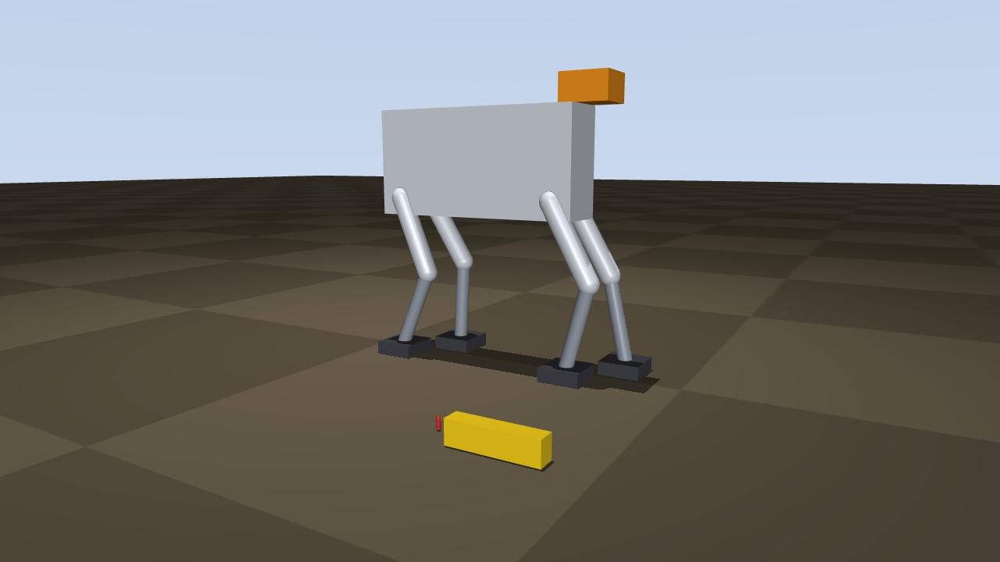

# Análisis Exhaustivo de la Viabilidad Estructural y Cinemática de Sistemas Robóticos Bípedos a Gran Escala: Intersección entre la Ley Cuadrado-Cúbica, Metamateriales TPMS y Geomecánica

## 1. Introducción al Paradigma del Escalado Biomecánico y Robótico

Los robots antropomórficos de gran escala, los «mechas» de la ciencia ficción, chocan con un principio geométrico que Galileo describió en 1638: la ley cuadrado-cúbica. Cuando un objeto se agranda manteniendo sus proporciones, su masa crece con el cubo del factor de escala y las secciones que la sostienen solo con el cuadrado. A esto se suman tres problemas propios de las máquinas que caminan: el par que deben dar las articulaciones, la potencia y la masa de los actuadores, y la capacidad del suelo para soportar el peso concentrado en un pie.

La fabricación aditiva permite producir materiales celulares como las superficies mínimas triplemente periódicas (TPMS), y entre ellas el giroide, con densidad y rigidez ajustables. Este informe evalúa si esas estructuras cambian el límite de tamaño de un robot bípedo, compara materiales (polímeros reforzados con fibra de carbono y titanio Ti-6Al-4V), analiza la actuación hidráulica y la mecánica de suelos, y valida las conclusiones con tres simulaciones: un análisis por elementos finitos de celdas giroides, un modelo de dimensionado del mecha en función de su altura y una simulación física de la marcha en MuJoCo, contrastada en Gazebo.

**Conclusión principal.** Un mecha bípedo que camina puede medir unos 30 m con materiales y actuadores actuales en un escenario base realista, en un rango de unos 6 m (supuestos de la robótica actual) a unos 80 m (supuestos optimistas). El límite lo fija la masa de los actuadores y del sistema de energía, que crece más rápido que el propio mecha, y no la resistencia de la estructura. Rellenar las piernas con giroide no ayuda: reduce la altura máxima de 29 m a 18 m en el escenario base. El suelo solo limita en terrenos blandos: un mecha de 50 m puede caminar sobre arena densa, arcilla dura o roca, y se hunde en arcilla blanda.

## 2. Fundamentos Físicos de la Ley Cuadrado-Cúbica en Sistemas Mecánicos

Si todas las dimensiones lineales de un cuerpo se multiplican por un factor k, sus áreas crecen con k² y su volumen y su masa con k³. Esta relación, descrita por Galileo en Dos nuevas ciencias (1638), es la base de todo el análisis que sigue.

### Implicaciones Estructurales y Concentración de Tensiones

La resistencia de una pieza depende de su sección, mientras que la carga que soporta por su propio peso depende de su volumen. La tensión por peso propio, σ = F/A, escala por tanto como k³/k² = k: a densidad constante, cualquier estructura acaba fallando bajo su propio peso si se agranda lo suficiente.

Los animales grandes no compensan este efecto solo con huesos más gruesos. Entre 0.04 y 300 kg, los mamíferos mantienen constante la tensión en sus huesos cambiando de postura: los grandes caminan más erguidos y alinean las patas con la fuerza del suelo, con un factor de seguridad óseo de 2 a 4 ([Biewener, Science 1989](https://doi.org/10.1126/science.2740914); [Biewener, J. Exp. Biol. 2005](https://doi.org/10.1242/jeb.01520)). Por encima de unos 300 kg aparecen huesos proporcionalmente más gruesos y menos agilidad: los elefantes no galopan, y los saurópodos de 50 a 80 t caminaban a menos de 2 m/s.

En una máquina, la estructura puede aprovechar toda la sección de la pierna como un tubo de pared delgada, igual que el exoesqueleto de un insecto. El modelo de dimensionado de la sección 9 muestra que, así diseñada, la estructura de las piernas de un mecha de 20 m necesita paredes de titanio de pocos milímetros y pesa menos del 20 % del total. La estructura no es el factor que limita la altura.

### Cinemática e Inercia Transitoria en el Escalado Robótico

El momento de inercia de una pierna crece con k⁵ (masa k³ por distancia al cuadrado k²). Si se exigiera a un gigante la misma aceleración angular que a una persona, el par necesario crecería también con k⁵. Pero ni los animales ni las máquinas grandes se mueven así: lo natural es la similitud dinámica, con el mismo número de Froude (v²/gL), en la que los tiempos crecen con √k y las aceleraciones angulares caen con 1/k. Entonces el par necesario crece con m·L, es decir con k⁴ ([Oke et al. 2026](https://arxiv.org/abs/2603.22560)). La simulación de la sección 9 lo confirma: el par pico de rodilla dividido entre peso × altura vale 0.126 tanto a 1.75 m como a 28 m.

Un cilindro hidráulico a presión fija da una fuerza proporcional a su área (k²) y un par proporcional a la fuerza por el brazo de palanca (k³). Los motores eléctricos escalan de forma empírica entre k³ y k⁴. El déficit entre el par necesario y el disponible crece por tanto entre k⁰ y k¹, una ley de potencia moderada. La consecuencia que más pesa es otra: para dar ese par, la masa de los actuadores crece con k⁴, más rápido que la masa del mecha (sección 7).

La similitud dinámica también fija la velocidad: con el mismo número de Froude, la velocidad crece con √k. Un mecha de 20 m que camine con la soltura relativa de una persona a paso lento (número de Froude de alrededor de 0.01) avanza a unos 0.9 m/s.

### Máquinas Caminantes de Gran Tamaño Construidas

Ningún bípedo de más de unas 1.5 t ha caminado libre y sin cable. El mayor robot que camina es Tradinno, un dragón cuadrúpedo hidráulico de 11 t y 8.2 m de alto. LW Mononofu (8.5 m, 7.3 t) se desplaza sobre ruedas, y el Gundam de Yokohama (18 m, 25 t) cuelga de una estructura de soporte, no carga peso en las piernas y usa solo actuadores eléctricos. Las masas de estas máquinas quedan entre los escenarios base y pesimista del modelo de la sección 9 (Figura 1).

*Figura 1: Masa del mecha diseñado en función de su altura para tres conceptos de pierna y tres escenarios, comparada con máquinas reales.*

## 3. Topología de Superficies Mínimas Triplemente Periódicas (TPMS)

Las superficies mínimas triplemente periódicas tienen curvatura media nula y se repiten en las tres direcciones del espacio. En fabricación aditiva se usan para producir materiales celulares de densidad y rigidez ajustables, como alternativa a los enrejados de barras, los paneles de abeja y las espumas metálicas.

### La Naturaleza Matemática y Geométrica del Giroide

El giroide fue descrito por Alan Schoen en la NASA en 1970 ([NASA TN D-5541](https://ntrs.nasa.gov/citations/19700020472)). Divide el espacio en dos laberintos entrelazados que no se cortan. En la práctica se aproxima con la función sin x·cos y + sin y·cos z + sin z·cos x y se fabrica de dos formas: como una lámina engrosada sobre la superficie (giroide lámina) o rellenando uno de los dos laberintos (giroide red). Al engrosarse, la pieza ya no tiene curvatura media nula, y las dos formas se comportan como materiales distintos.

El análisis por elementos finitos de la sección 9 muestra que el giroide lámina es casi isótropo (razón de Zener de 1.08 a 1.14, en línea con [Li et al. 2019](https://pmc.ncbi.nlm.nih.gov/articles/PMC6650998)), mientras que el giroide red es claramente anisótropo (de 1.3 a 2.3). Su geometría suave reduce los picos de tensión frente a los enrejados de barras, pero no los elimina: con una densidad del 20 %, el 1 % más cargado del material de un giroide lámina soporta unas 15 veces la tensión media aplicada. Los defectos internos y la rugosidad de la impresión siguen iniciando grietas por fatiga.

### El Estudio del MIT de 2017: Qué se Simuló y Qué se Midió

[Qin et al. (Science Advances, 2017)](https://pmc.ncbi.nlm.nih.gov/articles/PMC5218516) calcularon por dinámica molecular que un ensamblaje desordenado de grafeno con el 4.6 % de la densidad del acero dulce tenía una resistencia a tracción 10 veces mayor que la de este. La compactación con calor y presión fue simulada. Los únicos ensayos físicos se hicieron con giroides de polímero impresos en 3D, unas 10⁷ veces mayores que los modelos atómicos. El módulo simulado, 2.8 GPa, es alrededor del 1.4 % del del acero.

Buehler afirmó que «la geometría es el factor dominante», y el artículo propone usar esa geometría con otros materiales. Pero el mismo artículo concluye que las propiedades «disminuyen con la densidad mucho más rápido que las de las espumas poliméricas»: el módulo cae con ρ2.7 y la resistencia con ρ2.0 a ρ3.0. El estudio no muestra que un giroide de metal o polímero supere al material macizo en resistencia por unidad de peso.

## 4. Modelado Matemático de Sólidos Celulares: Leyes de Gibson-Ashby

El módulo de elasticidad y el límite de fluencia de un sólido celular dependen de su densidad relativa ρ = ρ*/ρs según las leyes de Gibson-Ashby: E*/Es = C₁·ρm y σ*/σs = C₂·ρn, donde Es y σs son las propiedades del material macizo y C₁, C₂, m y n dependen de la arquitectura. En giroides, los exponentes publicados son m ≈ 1.1–1.6 en lámina y 1.7–2.4 en red, y n ≈ 1.3–2.0.

La Tabla 1 recoge valores medidos y calculados con una densidad relativa del 20 %. La última columna compara la resistencia por kilo del giroide con la del material macizo.

| Fuente | E*/Es | σ*/σs | Resistencia por kilo frente al macizo |
|---|---|---|---|
| Ti-6Al-4V por fusión láser, giroide lámina (Naghavi et al. 2022) | 7.1 % | 5.2 % | 26 % |
| Ti-6Al-4V por haz de electrones, giroide lámina (Polley et al. 2022) | 2.9 % | 8.3 % | 41 % |
| Acero maraging, giroide lámina (Al-Ketan et al. 2018) | 1.4 % | 8.9 % | 44 % |
| Acero maraging, giroide red (Al-Ketan et al. 2018) | 0.9 % | 6.0 % | 30 % |
| Espuma de celda abierta clásica (Gibson y Ashby) | 4.0 % | 2.7 % | 13 % |
| Elementos finitos propios, giroide lámina | 6.9 % | 6.7 % (inicio de fluencia) | 34 % |
| Elementos finitos propios, giroide red | 2.9 % | 2.8 % (inicio de fluencia) | 14 % |

*Tabla 1: Rigidez y resistencia relativas de giroides con una densidad relativa del 20 %. En los ensayos metálicos, la rigidez medida con el desplazamiento del cabezal tiende a quedar por debajo del valor real.*

En todos los casos la resistencia por kilo es menor que la del material macizo, y la teoría impide superarla: en cualquier material poroso σ*/σs ≤ ρ (cota de Voigt; [Wang et al., PNAS 2022](https://pmc.ncbi.nlm.nih.gov/articles/PMC9407660)). Para una pieza que soporta su propio peso, lo que cuenta es esa resistencia por kilo, así que eliminar el 80 % de la masa con un giroide reduce la resistencia todavía más: con un 20 % de densidad queda entre el 3 % y el 9 % de la del macizo. [Evans, Hutchinson y Ashby (1998)](https://groups.seas.harvard.edu/hutchinson/papers/473.pdf) lo resumen: los metales celulares no aportan ventaja en diseños gobernados por la carga límite.

El giroide sí es útil como núcleo de paredes delgadas, donde impide el pandeo local, para absorber impactos gracias a su meseta de deformación larga y como intercambiador de calor (sección 7). En el modelo de la sección 9, una pierna de tubo de titanio con núcleo de giroide alcanza prácticamente la misma altura que el tubo solo, y una pierna rellena de giroide se queda en un 60 % de esa altura.

*Figura 2: Rigidez, resistencia y resistencia específica de giroides frente a la densidad relativa: elementos finitos propios, ensayos publicados y límite teórico.*

## 5. Análisis de Materiales: El Atractivo y las Limitaciones de la Fibra de Carbono (CFRP)

Los polímeros reforzados con fibra de carbono tienen una de las mejores relaciones entre resistencia y peso de los materiales estructurales habituales, pero su comportamiento depende mucho de cómo se fabriquen.

### Anomalías Estructurales de las Fibras de Carbono Cortas en Topologías TPMS

[Saleh et al. (Polymers, 2022)](https://pmc.ncbi.nlm.nih.gov/articles/PMC9654767/) imprimieron por deposición fundida estructuras de diamante, giroide y primitiva en PLA y en PLA con un 15 % de fibra de carbono corta, con densidades relativas del 23 al 44 % y celdas de 6, 8 y 12 mm. Entre todas las probetas, el módulo de compresión varió de 0.09 a 0.47 GPa y la resistencia de 2.98 a 13.89 MPa. La fibra aumentó siempre el módulo, pero su efecto sobre la resistencia dependió de la topología (Tabla 2). Con una densidad del 44 % y celdas de 12 mm, la fibra también redujo la energía absorbida. Los autores lo atribuyen a que las paredes más gruesas reciben más fibra y se vuelven más rígidas y frágiles, y observan que las grietas empiezan siempre entre capas. El propio filamento con fibra es más rígido pero menos resistente a tracción que el PLA (48 frente a 56 MPa) y menos dúctil.

| Topología | Efecto de añadir fibra de carbono corta al PLA |
|---|---|
| Diamante | Ligera mejora de la resistencia pico y de la energía absorbida en la mayoría de los casos |
| Giroide | Menor resistencia pico, más acusada cuanto mayor es la densidad |
| Primitiva | Menor resistencia pico, más acusada cuanto mayor es la densidad |

*Tabla 2: Efecto de la fibra de carbono corta en estructuras TPMS impresas por deposición fundida (Saleh et al. 2022).*

### La Fibra de Carbono Continua (CCF) en Geometrías TPMS

La fibra continua refuerza mucho más que la corta, pero en impresión 3D solo puede seguir trayectorias dentro de cada capa. Aun así, ya se han impreso giroides y diamantes con fibra continua: [Szederkényi et al. (2024)](https://real.mtak.hu/206352/1/1843_open_ECCM21_Proceeding_CFRP_TPMS_crush.pdf) midieron un 81 % más de módulo específico que en poliamida sin refuerzo, aunque las piezas se delaminaron entre capas y absorbieron menos energía. La debilidad en la dirección de apilado (eje Z) descarta el CFRP impreso para piezas cargadas en todas las direcciones.

Esa limitación es del proceso de impresión, no del material. Un tubo de CFRP laminado o enrollado, que es lo habitual en aeronáutica, no la tiene: en el modelo de la sección 9, unas piernas de tubo de CFRP cuasi-isótropo dan la mayor altura de todos los materiales evaluados (33 m en el escenario base).

## 6. Aleaciones de Titanio (Ti-6Al-4V) mediante Fabricación Aditiva Metálica

El Ti-6Al-4V de grado aeroespacial combina baja densidad, alta resistencia y buena resistencia a la corrosión, y es el metal más usado en fusión láser en lecho de polvo (LPBF).

### Propiedades del Titanio Macizo y del Titanio Giroide por Fusión Láser

Recocido, el Ti-6Al-4V tiene una densidad de 4.43 g/cm³, un módulo de 113.8 GPa, una fluencia de 880 MPa y una resistencia a tracción de 950 MPa. Tal como sale de la impresora LPBF, con alivio de tensiones, es más resistente (fluencia de 1141 MPa) pero menos dúctil y anisótropo: según la orientación de impresión, la fluencia varía de 761 a 820 MPa ([Jamshidi et al. 2020](https://pmc.ncbi.nlm.nih.gov/articles/PMC7345457)). Solo tras un prensado isostático en caliente (HIP) es isótropo y consistente, con una fluencia de 928 MPa ([Mahmud et al. 2021](https://inldigitallibrary.inl.gov/sites/sti/sti/Sort_63131.pdf)).

La fatiga es lo que más penaliza a las piezas impresas. La rugosidad superficial reduce la resistencia a fatiga del Ti-6Al-4V sin mecanizar a unos 210–300 MPa; con HIP y acabado superficial sube a unos 450–600 MPa. En los enrejados, la resistencia a fatiga dividida entre su fluencia es inferior a 0.2 en estructuras de barras (Yavari et al. 2013) y de 0.45 a 0.5 en giroides lámina en compresión (Kelly et al. 2021; Polley et al. 2022), las mejores entre los enrejados metálicos.

Los TPMS de lámina superan a los enrejados de barras en resistencia, absorción de energía y fatiga, y entre ellos el diamante suele dar los mejores resultados (Al-Ketan et al. 2018). Bajo compresión fuerte, los enrejados de titanio se deforman formando bisagras plásticas y bandas de cortante a lo largo de una meseta de carga larga (Ataee et al. 2018, en titanio comercialmente puro): un fallo progresivo y no frágil, pero plástico.

En el modelo de dimensionado, con piernas de tubo de pared delgada en el escenario base, la altura máxima es de 29 m para el Ti-6Al-4V con HIP, 22 m sin HIP, 25 m para el acero 4340 y 23 m para el aluminio 7075-T6. El titanio con HIP es una buena opción, aunque no la única, y la arquitectura de la pieza importa más que el material.

## 7. Actuación Mecánica, Locomoción y Desafíos Termodinámicos de Grandes Escalas

### Cargas de la Marcha Bípeda

Al caminar, la fuerza vertical del suelo sobre el pie alcanza de 1.0 a 1.5 veces el peso corporal; al correr, de 2.0 a 2.9 veces ([Nilsson y Thorstensson 1989](https://pubmed.ncbi.nlm.nih.gov/2782094/); Keller et al. 1996). En la simulación de la sección 9, la marcha del mecha produce un pico de 1.35 veces su peso a cualquier escala. En unidades humanas, los pares articulares pico son 2.2 N·m/kg en la rodilla, 1.6 en el tobillo y 1.1 en la cadera, frente a 0.9, 1.6 y 0.9 N·m/kg medidos en personas; la rodilla trabaja más porque los robots caminan con las rodillas flexionadas.

Los cuadrúpedos reparten mejor esas cargas entre varios apoyos. El guepardo flexiona la columna para alargar la zancada, y el primer MIT Cheetah imitó esa columna flexible; el Cheetah 3, en cambio, tiene un tronco rígido. Un bípedo concentra todo su peso en un pie durante el apoyo simple, lo que hace de la presión sobre el suelo un problema propio de esta configuración (sección 8).

### Escalado de Densidad de Potencia: Del Motor al Actuador EHA

La hidráulica es la opción natural para fuerzas grandes: un cilindro a 21 MPa trabaja con unas 60 veces la tensión máxima de un músculo. Los robots hidráulicos operan a 16–21 MPa (Atlas, HyQ). La hidráulica controlada por válvulas es poco eficiente: un 22 % de media y un 14 % en maquinaria móvil ([ORNL/TM-2011/14](https://info.ornl.gov/sites/publications/files/pub28014.pdf)). Los actuadores electrohidrostáticos (EHA), con una bomba propia por actuador, evitan las pérdidas de las válvulas y llegan al 70–87 % de eficiencia en su mejor punto, aunque en un ciclo real de robot la mayoría de los puntos de operación están entre el 30 y el 60 % (Du et al. 2024 y 2026).

El problema de escala de los actuadores no es su fuerza sino su masa. La masa de un cilindro es proporcional al trabajo de su carrera (fuerza por carrera), que crece con k⁴: un gato industrial de 700 bar pesa de 0.24 a 0.34 kg por kJ, y un actuador de robótica, de 2 a 3 kg por kJ. La potencia de la marcha crece con k3.5, y un grupo diésel con su bomba rinde de 0.10 a 0.15 kW/kg. Ambas fracciones de masa crecen con la altura: en el escenario base, los actuadores de las piernas y el sistema de energía suman el 32 % de la masa a 20 m y el 42 % a 28 m (Figura 3). Ese crecimiento es el que fija la altura máxima.

*Figura 3: Desglose de la masa del mecha (tubo de titanio, escenario base) en función de su altura. Cuando la suma de fracciones llega al 100 %, la masa deja de converger.*

### El Giroide como Intercambiador de Calor

Una máquina de cientos de kilovatios tiene que disipar mucho calor, y el giroide es un buen intercambiador: las TPMS dan números de Nusselt de 8 a 10 veces los de un haz de barras ([Prussack et al. 2024](https://www.osti.gov/biblio/2396699)). A cambio, el factor de fricción del giroide es unas 90 veces mayor, una penalización que se paga en potencia de bombeo, sobre todo con un aceite hidráulico viscoso. El diamante o el Schwarz-D suelen igualarlo o superarlo. Integrar canales de refrigeración en piezas impresas es viable, pero no reduce la masa de actuación y energía.

## 8. Restricciones Geotécnicas: La Capacidad Portante del Suelo

Todo el peso del mecha y las fuerzas de la marcha se transmiten al terreno a través de un pie durante el apoyo simple. Hay que distinguir dos valores. La capacidad portante admisible es la presión que los códigos de construcción permiten sin estudio del terreno, con un factor de seguridad de 2 a 4 y pensada para limitar los asentamientos de un edificio. La capacidad portante última es la presión a la que el terreno rompe.

Valores admisibles presuntos del Código Internacional de Construcción (IBC, tabla 1806.2):

- **Arcilla y limo:** 72 kPa (1500 psf).
- **Arena, arena limosa o arcillosa:** 96 kPa (2000 psf).
- **Grava arenosa o grava:** 144 kPa (3000 psf).
- **Roca sedimentaria o foliada:** 192 kPa (4000 psf).
- **Roca cristalina:** 575 kPa (12 000 psf).
Son valores conservadores para cimentar edificios. El granito intacto resiste más de 100 a 250 MPa a compresión ([Marinos y Hoek 2000](https://www.rocscience.com/assets/resources/learning/hoek/GSI-A-Geologically-Friendly-Tool-for-Rock-Mass-Strength-Estimation-2000.pdf)), el [código de Nueva York](https://www.nyc.gov/assets/buildings/codes-pdf/cons_codes_2022/2022BC_Chapter18_SoilsFoundationsWBwm.pdf) admite 5.7 MPa sobre roca dura sana y el de Hong Kong hasta 12.5 MPa. Las excavadoras de rodete de la clase de la Bagger 288 y la Bagger 293 (96 m y 14 200 t, sobre 12 orugas) trabajan a unos 170 kPa, por encima del valor admisible para arena y grava.

La capacidad última depende del tipo de suelo (Terzaghi, con los factores de Vesić). En arcilla saturada cargada con rapidez vale unas 5.14 veces su resistencia al corte y no depende del tamaño del pie, así que un mecha más grande acaba superándola. En arena y grava crece con el ancho del pie: si el pie crece en proporción, la presión y la capacidad crecen igual. La Tabla 3 aplica esto a un mecha con la densidad de un cuerpo humano (13 kg/m³ × H³) y pies de proporciones humanas, apoyado en un solo pie con 1.3 veces su peso, y lo compara con la simulación con suelo deformable.

| Suelo | Mecha de 20 m (104 t), 398 kPa | Mecha de 50 m (1630 t), 996 kPa |
|---|---|---|
| Arcilla blanda (cu = 25 kPa) | Capacidad 138 kPa. Simulación: se hunde 1.4 m y cae | Capacidad 138 kPa. Simulación: se hunde 10.5 m y cae |
| Arcilla firme (cu = 75 kPa) | Capacidad 413 kPa. Simulación: camina | Capacidad 413 kPa. Hundimiento calculado de unos 19 m |
| Arcilla dura (cu = 150 kPa) | Capacidad 825 kPa | Capacidad 825 kPa. Simulación: camina |
| Arena densa | Capacidad 697 kPa. Simulación: camina | Capacidad 1743 kPa. Simulación: camina |
| Granito sano | Más de 17 MPa | Más de 17 MPa. Simulación: camina |

*Tabla 3: Capacidad portante última frente a la presión bajo el pie de un mecha con densidad humana, y resultado de la simulación con suelo deformable.*

Un mecha gigante se hundiría en suelos blandos, pero no rompería la roca ni el pavimento: 1 MPa bajo el pie de un mecha de 50 m es menos del 1 % de la resistencia del granito, y el pavimento de un aeropuerto admite presiones de neumático de hasta 1.75 MPa. En arcilla blanda, en cambio, necesitaría pies varias veces más grandes que los proporcionales. Como referencia, una máquina de 14 200 t apoyada con 2.5 veces su peso sobre arena con 96 kPa admisibles necesitaría unos 3600 m² por pie, un cuadrado de unos 60 m de lado.

*Figura 4: Presión bajo un pie frente a la capacidad portante última de distintos terrenos. Los 575 kPa son el valor admisible de código para roca cristalina, no su resistencia.*

## 9. Validación con Simulaciones

Para comprobar los argumentos anteriores se construyeron tres herramientas, cuyo código, datos y vídeos están en [github.com/dobleuber/realistic-mechas](https://github.com/dobleuber/realistic-mechas):

- **Elementos finitos de celdas giroides.** Homogenización periódica por vóxeles de giroides lámina y red entre el 10 y el 50 % de densidad, para obtener su rigidez, su anisotropía y su concentración de tensiones, con la malla convergida al 1 %.
- **Modelo de dimensionado del mecha.** Para cada altura diseña las piernas (tubos con pandeo local según NASA SP-8007, o secciones rellenas de giroide según Gibson-Ashby), los cilindros hidráulicos, el grupo de potencia y el combustible, y resuelve la masa de forma autoconsistente. Si la masa no converge, esa altura no se puede construir. Usa tres escenarios de parámetros (sección 11).
- **Simulación física de la marcha** en MuJoCo, con verificación cruzada en Gazebo Harmonic. Un bípedo con las proporciones y masas del cuerpo humano (tablas de Winter) camina con control predictivo del punto de momento cero (Kajita et al. 2003), con el par de cada articulación limitado al de su actuador y, en algunos casos, sobre un suelo que se hunde según su capacidad portante.

### Similitud Dinámica

Escalando el tiempo con √H, el mismo plan de marcha produce los mismos pares normalizados a cualquier altura (0.126 en la rodilla, 0.091 en el tobillo y 0.067 en la cadera, en unidades de peso por altura) y la misma fuerza pico sobre el suelo, 1.35 veces el peso. Esto confirma que el par necesario crece con H⁴ y la potencia con H3.5.

### Resultados

| Caso | MuJoCo | Gazebo |
|---|---|---|
| Persona de referencia (1.75 m, 70 kg) | Camina 1.86 m | Camina 1.86 m |
| Mecha de 20 m, diseño base (9.5 t) | Camina 21.3 m a 0.93 m/s; potencia pico 102 kW | Camina 21.3 m |
| Mecha de 28 m, diseño base (47 t) | Camina 29.8 m a 1.11 m/s; potencia pico 603 kW | Camina 29.8 m |
| 20 m con actuadores al 50–90 % del par necesario | Cae | Cae (probado al 70 %) |
| 20 m con densidad humana en arcilla blanda | Se hunde 1.4 m y cae | No simulado |
| 50 m con densidad humana en arena densa, arcilla dura o granito | Camina | No simulado |

*Tabla 4: Resultados de la simulación de la marcha en MuJoCo y en Gazebo.*

Con actuadores por debajo del 100 % del par pico necesario el mecha cae, y con el 100 % o más camina: no hay margen para ahorrar masa en los actuadores. Como esa masa crece con H⁴, es la que fija la altura máxima. Los vídeos de cada caso están en el repositorio: [marcha a 20 m](https://github.com/dobleuber/realistic-mechas/blob/main/results/videos/e1_marcha_H20.mp4), [marcha a 28 m](https://github.com/dobleuber/realistic-mechas/blob/main/results/videos/e1_marcha_H28.mp4), [actuadores al 60 %](https://github.com/dobleuber/realistic-mechas/blob/main/results/videos/e2_par_60pct_H20.mp4), [20 m en arcilla blanda](https://github.com/dobleuber/realistic-mechas/blob/main/results/videos/e3_arcilla_blanda_H20.mp4), [50 m en arcilla blanda](https://github.com/dobleuber/realistic-mechas/blob/main/results/videos/e3_arcilla_blanda_H50.mp4) y [50 m en arena densa](https://github.com/dobleuber/realistic-mechas/blob/main/results/videos/e3_arena_densa_H50.mp4).

*Figura 5: Pares normalizados frente a la altura (izquierda), distancia recorrida según el par disponible (centro) y hundimiento sobre distintos suelos (derecha).*

## 10. Un Mecha Cuadrúpedo con Patas de Elefante

Los animales terrestres más grandes de la historia han sido cuadrúpedos. Los mayores saurópodos rondaban las 50–90 t, frente a unas 6–8 t de los mayores bípedos obligados, como el T. rex (Benson et al. 2014). Entre los animales vivos, el mayor es el elefante africano: los machos pesan 6 t de media y los récords superan las 9.5 t (Larramendi 2016). Esta sección comprueba si un mecha con la forma de un elefante puede ser más grande que el bípedo de las secciones anteriores.

### Proporciones, Postura y Marcha

El mecha copia las proporciones medidas en elefantes, normalizadas con la altura de la cadera L. El tronco mide lo mismo que la pata, unos 0.95 L entre hombro y cadera, y los pies van separados unos 0.27 L (estimado a partir de Belyaev et al. 2025). El 60 % del peso cae sobre las patas delanteras (Ren et al. 2010) y los pies son almohadillas redondas de unos 0.04 L² (derivado de Panagiotopoulou et al. 2016). A mitad del apoyo, el codo y la rodilla solo se flexionan 23° y 28° (Ren et al. 2008), y el animal camina en secuencia lateral, con tres pies en el suelo la mayor parte del ciclo (Usherwood y Self Davies 2017).

Cada pata del mecha es una pierna del bípedo, y las cuatro suman la misma masa que las dos piernas. La marcha mantiene siempre al menos tres pies en el suelo (factor de apoyo 0.79, por encima del 0.75 que exige la estabilidad estática; McGhee y Frank 1968), así que el mecha avanza al 45 % de la velocidad del bípedo de la sección 9. Con cuatro patas, el reparto del peso entre los pies no queda determinado: los pares se calcularon por dinámica inversa con el reparto que minimiza el esfuerzo de las articulaciones, como haría un control de fuerza, y la simulación en MuJoCo comprobó que el mecha camina sin caerse. El bípedo se recalculó con el mismo método, a su velocidad y a la del elefante.

### Tamaño Máximo del Mecha Tipo Elefante

La Tabla 5 compara el mecha tipo elefante con el bípedo. Todas las cifras suponen un control ideal y por eso son mayores que las de la Tabla 6, que salen de los picos medidos con servos; lo que vale es la comparación entre filas.

| Diseño | Velocidad | Actuadores (Σ par × recorrido) | Tamaño máximo | Masa al 80 % del límite |
|---|---|---|---|---|
| Bípedo, marcha de la sección 9 | 100 % | 0.84 | 42 m de alto (piernas de 22 m) | 42 t |
| Bípedo a la velocidad del elefante | 43 % | 0.64 | 58 m de alto (piernas de 31 m) | 100 t |
| Cuadrúpedo tipo elefante | 45 % | 0.71 | Patas de 34 m, lomo a 53 m y 41 m de largo | 445 t |

*Tabla 5: Mecha tipo elefante frente al bípedo, calculados igual (dinámica inversa con control ideal, escenario base). La velocidad es relativa a la marcha de la sección 9; los actuadores, la suma normalizada de par × recorrido de todas las articulaciones.*

El mecha tipo elefante no es más alto que un bípedo que camine a su misma velocidad: su lomo llega a 53 m y la cabeza del bípedo, a 58 m. Pero cerca de su límite pesa unas 4.5 veces más (445 t frente a 100 t), apoya con una presión parecida (69 kPa por pie, frente a 56 kPa) y nunca necesita mantener el equilibrio: puede detenerse en cualquier momento sin caerse. Con patas de 27 m camina a unos 0.7 m/s.

El rasgo que más ayuda es la postura. Con las patas casi rectas, la fuerza del suelo pasa cerca de las rodillas y la suma de actuadores baja un 16 % frente a un cuadrúpedo con las patas flexionadas del bípedo. La vía estrecha y los pies grandes ahorran un 5 % cada uno; el largo y el canto del cuerpo no influyen. El codo hacia atrás del elefante real, en cambio, aumenta esa suma un 22 % en el mecha, así que el diseño dobla las patas delanteras hacia delante.

*Figura 6: Mecha tipo elefante en MuJoCo al 80 % de su tamaño máximo: patas de 27 m, lomo a 42 m y 445 t. La figura roja es una persona de 1.75 m y la caja amarilla, un autobús de 12 m. [Vídeo de la marcha](https://github.com/dobleuber/realistic-mechas/blob/main/results/videos/animal_elefante.mp4).*

**Limitaciones.** Los elefantes caminan con un factor de apoyo de 0.73–0.74 y a números de Froude de 0.09–0.10 (Ren y Hutchinson 2008), mucho más deprisa que este mecha (0.0017); bajar de 0.75 exigiría equilibrio dinámico, que el planificador no modela. Además, las patas del mecha tienen dos segmentos iguales, mientras que en el elefante el fémur mide 1.75 veces la tibia, y el control es ideal.

## 11. Conclusión General: El Límite Práctico del Escalado

Del análisis y las simulaciones se desprenden cinco conclusiones:

- **El giroide no compensa la ley cuadrado-cúbica.** Su resistencia por kilo es siempre menor que la del material macizo, así que unas piernas rellenas de giroide alcanzan menos altura que unos tubos de pared delgada. Su utilidad está en núcleos contra el pandeo, absorción de impactos e intercambio de calor.
- **La arquitectura importa más que el material.** Los tubos de pared delgada de Ti-6Al-4V con HIP o de CFRP laminado dan las mayores alturas; el titanio impreso sin HIP y el CFRP impreso quedan penalizados por la fatiga y la anisotropía.
- **Los actuadores y la energía fijan el límite.** Su masa crece con H⁴ y H3.5, mientras el mecha crece con H³. Los EHA mejoran la eficiencia, pero no cambian esa tendencia.
- **El suelo depende del terreno.** En arcilla blanda, un mecha de 20 m con densidad humana se hunde; en arena densa, arcilla dura, roca o pavimento, incluso uno de 50 m camina.
- **Cuatro patas de elefante dan un mecha más masivo y estable, no más alto.** Con el mismo método, el mecha tipo elefante llega casi a la altura de un bípedo que camine a su velocidad (53 m de lomo frente a 58 m de cabeza), con unas 4.5 veces su masa cerca del límite y sin riesgo de caer.
La Tabla 6 resume la altura máxima por concepto de pierna y escenario.

| Piernas | Optimista | Base | Pesimista |
|---|---|---|---|
| Tubo de Ti-6Al-4V de pared delgada | 79 m | 29 m | 6 m |
| Tubo con núcleo de giroide | 79 m | 28 m | 6 m |
| Sección rellena de giroide | 43 m | 18 m | Menos de 3 m |

*Tabla 6: Altura a la que la masa del mecha deja de converger, por concepto de pierna y escenario.*

Escenario optimista: actuadores de 0.24 kg/kJ, grupo de potencia de 300 W/kg, eficiencia del 60 % y márgenes de seguridad mínimos. Base: 0.5 kg/kJ, 150 W/kg, 45 % y factor de carga de diseño de 1.5. Pesimista: actuadores de la robótica actual (2 kg/kJ), 100 W/kg y 30 %.

En conclusión, ¿qué tan grande podría ser un mecha? Con tubos de pared delgada de titanio o fibra de carbono, actuadores hidráulicos y pies de proporciones normales sobre suelo firme, un mecha de unos 30 m que camine despacio, a alrededor de 1 m/s, es físicamente posible en el escenario base. Con supuestos optimistas el límite se acerca a 80 m; con los actuadores de la robótica actual baja a unos 6 m, el tamaño de las máquinas construidas hasta hoy. Lo que impide ir más allá es la masa de los actuadores y de la energía, no la resistencia de la estructura ni la roca bajo sus pies. En suelos blandos, el mecha necesitaría pies varias veces más grandes que los proporcionales.

*Figura 7: Altura máxima de un mecha bípedo que camina, por concepto de pierna y escenario.*

### Limitaciones del Análisis

- La marcha simulada es lenta y con los pies planos (número de Froude de alrededor de 0.01), como la de los humanoides grandes actuales. Correr multiplicaría las cargas por 2 o 3.
- El suelo deformable es un modelo cuasi-estático de punzonamiento: sirve para decidir si el mecha se hunde, no para predecir la forma de la huella.
- El análisis por elementos finitos es lineal: da el inicio de la plastificación, no la resistencia última. Para la resistencia se usan los ensayos publicados.
- No se modelan la fatiga de las uniones, el control del equilibrio ante empujones o caídas, ni la gestión térmica detallada.

#### Fuentes citadas

- Al-Ketan, Rowshan y Abu Al-Rub (2018). Topology-mechanical property relationship of 3D printed strut, skeletal, and sheet based periodic metallic cellular materials. Additive Manufacturing 19:167.
- Ataee et al. (2018). Acta Materialia 158:354.
- Belyaev et al. (2025). Comparative study of the body proportions in Elephantidae and other large herbivorous mammals. Journal of Anatomy 246:63. [doi.org/10.1111/joa.14143](https://doi.org/10.1111/joa.14143)
- Benson et al. (2014). PLoS Biology 12:e1001853. [doi.org/10.1371/journal.pbio.1001853](https://doi.org/10.1371/journal.pbio.1001853)
- Biewener (1989). Scaling body support in mammals: limb posture and muscle mechanics. Science 245:45. [doi.org/10.1126/science.2740914](https://doi.org/10.1126/science.2740914)
- Biewener (2005). Biomechanical consequences of scaling. Journal of Experimental Biology 208:1665. [doi.org/10.1242/jeb.01520](https://doi.org/10.1242/jeb.01520)
- Código de construcción de Nueva York 2022, capítulo 18. [nyc.gov](https://www.nyc.gov/assets/buildings/codes-pdf/cons_codes_2022/2022BC_Chapter18_SoilsFoundationsWBwm.pdf)
- Du et al. (2024). Energy 291:130417; Du et al. (2026). Tribology International 223:112258.
- Evans, Hutchinson y Ashby (1998). Cellular metals. Current Opinion in Solid State and Materials Science 3:288. [groups.seas.harvard.edu](https://groups.seas.harvard.edu/hutchinson/papers/473.pdf)
- GEO Technical Guidance Note 53 (Hong Kong, 2026). [cedd.gov.hk](https://www.cedd.gov.hk/filemanager/eng/content_427/TGN%2053_Issue%202.pdf)
- International Building Code, tabla 1806.2: valores presuntos de capacidad portante.
- Jamshidi et al. (2020). Materials 13:2813. [PMC7345457](https://pmc.ncbi.nlm.nih.gov/articles/PMC7345457)
- Kajita et al. (2003). Biped walking pattern generation by using preview control of zero-moment point. ICRA.
- Keller et al. (1996). Clinical Biomechanics 11:253.
- Kelly et al. (2021). Additive Manufacturing 41:101916.
- Larramendi (2016). Shoulder height, body mass, and shape of proboscideans. Acta Palaeontologica Polonica 61:537. [doi.org/10.4202/app.00136.2014](https://doi.org/10.4202/app.00136.2014)
- Li, Liao, Dai y Xie (2019). Materials 12:2183. [PMC6650998](https://pmc.ncbi.nlm.nih.gov/articles/PMC6650998)
- Love, Lanke y Alles (2012). Estimating the impact of the US fluid power industry. ORNL/TM-2011/14. [info.ornl.gov](https://info.ornl.gov/sites/publications/files/pub28014.pdf)
- Mahmud et al. (2021). Metals 11:1671. [inldigitallibrary.inl.gov](https://inldigitallibrary.inl.gov/sites/sti/sti/Sort_63131.pdf)
- Marinos y Hoek (2000). GSI: a geologically friendly tool for rock mass strength estimation. [rocscience.com](https://www.rocscience.com/assets/resources/learning/hoek/GSI-A-Geologically-Friendly-Tool-for-Rock-Mass-Strength-Estimation-2000.pdf)
- McGhee y Frank (1968). On the stability properties of quadruped creeping gaits. Mathematical Biosciences 3:331. [doi.org/10.1016/0025-5564(68)90090-4](https://doi.org/10.1016/0025-5564%2868%2990090-4)
- Naghavi et al. (2022). Bioengineering 9:504. [PMC9598079](https://pmc.ncbi.nlm.nih.gov/articles/PMC9598079/)
- Nilsson y Thorstensson (1989). Ground reaction forces at different speeds of human walking and running. Acta Physiologica Scandinavica 136:217. [PubMed 2782094](https://pubmed.ncbi.nlm.nih.gov/2782094/)
- Oke et al. (2026). Allometric Scaling Laws for Bipedal Robots. [arXiv:2603.22560](https://arxiv.org/abs/2603.22560)
- Panagiotopoulou et al. (2016). Royal Society Open Science 3:160203. [doi.org/10.1098/rsos.160203](https://doi.org/10.1098/rsos.160203)
- Polley et al. (2022). Journal of the Mechanical Behavior of Biomedical Materials 125:104882.
- Prussack et al. (2024). Applied Thermal Engineering. [OSTI 2396699](https://www.osti.gov/biblio/2396699)
- Qin, Jung, Kang y Buehler (2017). The mechanics and design of a lightweight three-dimensional graphene assembly. Science Advances 3:e1601536. [PMC5218516](https://pmc.ncbi.nlm.nih.gov/articles/PMC5218516)
- Ren et al. (2008). Journal of Experimental Biology 211:2735. [doi.org/10.1242/jeb.018820](https://doi.org/10.1242/jeb.018820)
- Ren et al. (2010). Integration of biomechanical compliance, leverage, and power in elephant limbs. PNAS 107:7078. [doi.org/10.1073/pnas.0911396107](https://doi.org/10.1073/pnas.0911396107)
- Ren y Hutchinson (2008). Journal of the Royal Society Interface 5:195. [doi.org/10.1098/rsif.2007.1095](https://doi.org/10.1098/rsif.2007.1095)
- Saleh, Anwar, Al-Ahmari y Alfaify (2022). Compression Performance and Failure Analysis of 3D-Printed Carbon Fiber/PLA Composite TPMS Lattice Structures. Polymers 14:4595. [PMC9654767](https://pmc.ncbi.nlm.nih.gov/articles/PMC9654767/)
- Schoen (1970). Infinite periodic minimal surfaces without self-intersections. NASA TN D-5541. [ntrs.nasa.gov](https://ntrs.nasa.gov/citations/19700020472)
- Szederkényi, Kovács y Czigány (2024). ECCM21. [real.mtak.hu](https://real.mtak.hu/206352/1/1843_open_ECCM21_Proceeding_CFRP_TPMS_crush.pdf)
- Tensar International. Bearing Capacity of Soil: Types and Calculations. [tensarinternational.com](https://www.tensarinternational.com/resources/articles/bearing-capacity-of-soil)
- Usherwood y Self Davies (2017). Work minimization accounts for footfall phasing in slow quadrupedal gaits. eLife 6:e29495. [doi.org/10.7554/eLife.29495](https://doi.org/10.7554/eLife.29495)
- Vulović et al. (2023). Strength Analysis of Eight-Wheel Bogie of Bucket Wheel Excavator. Metals 13:466. [mdpi.com](https://www.mdpi.com/2075-4701/13/3/466)
- Wang et al. (2022). PNAS 119:e2119536119. [PMC9407660](https://pmc.ncbi.nlm.nih.gov/articles/PMC9407660)
- Winter (2009). Biomechanics and Motor Control of Human Movement, 4.ª ed. Wiley.
- Yavari et al. (2013). Materials Science and Engineering C 33:4849. [doi.org/10.1016/j.msec.2013.08.006](https://doi.org/10.1016/j.msec.2013.08.006)
- Código, datos, figuras y vídeos de las simulaciones de este informe. [github.com/dobleuber/realistic-mechas](https://github.com/dobleuber/realistic-mechas)
